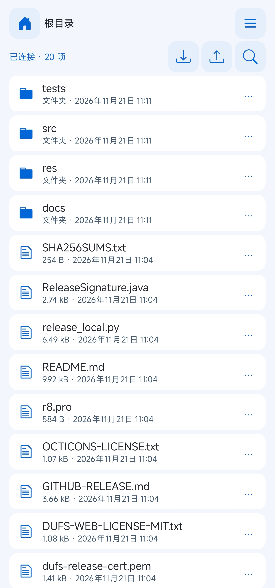
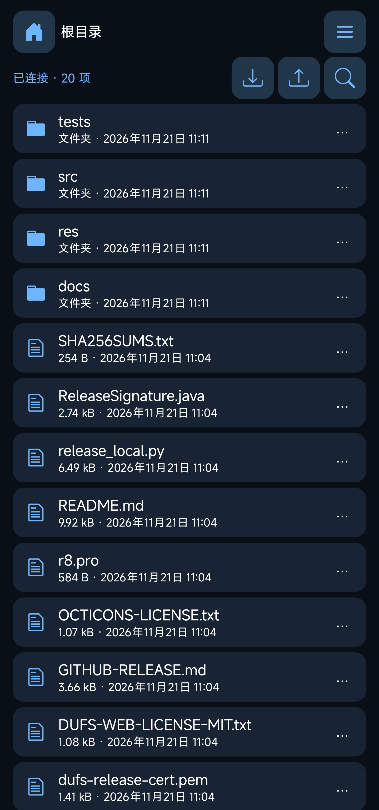
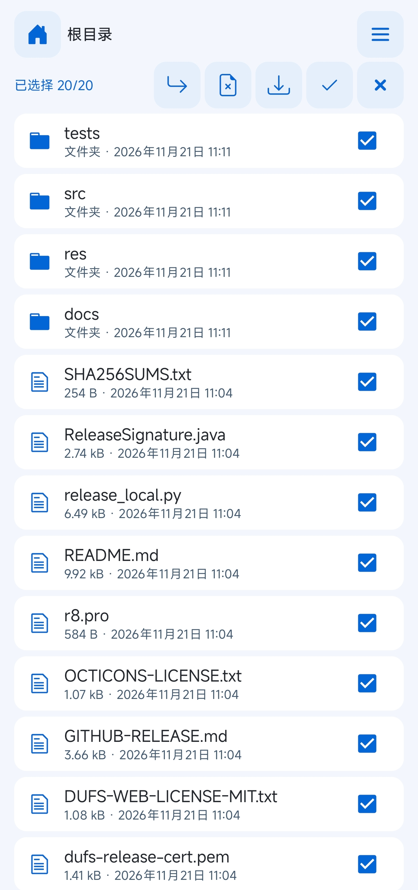
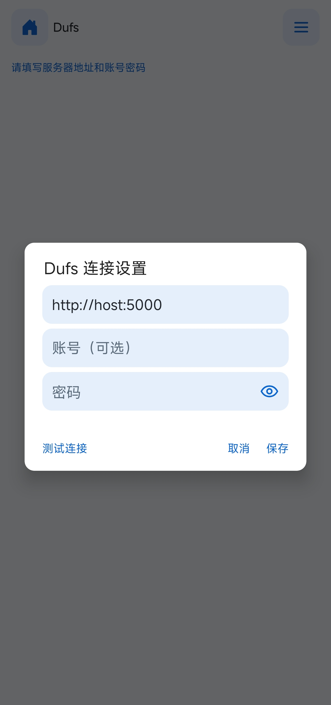
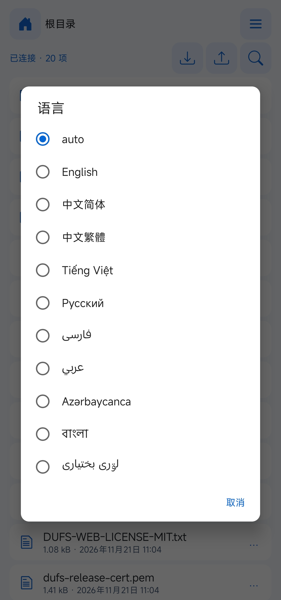
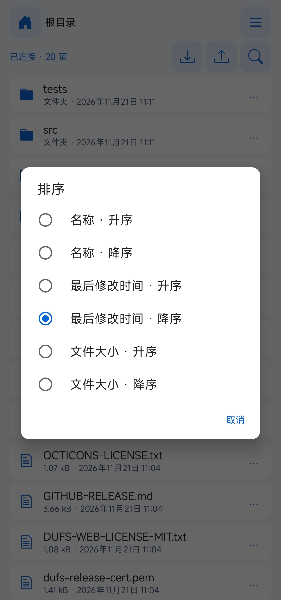
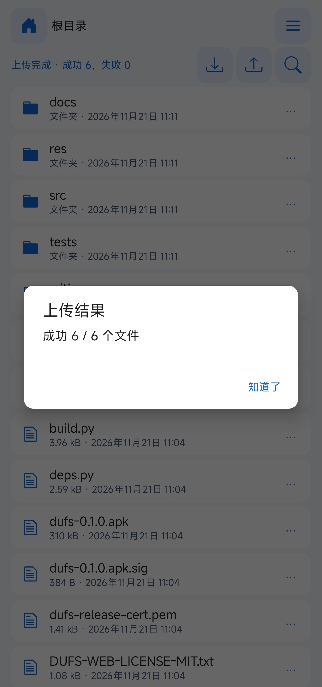

# Dufs Android

<p align="center">
  <strong>一个轻量、开源的 Dufs 文件服务器 Android 客户端</strong><br>
  <strong>A lightweight, open-source Android client for the Dufs file server</strong>
</p>

<p align="center">
  <a href="https://github.com/aZerinChan/Dufs-Android/releases/latest"></a>
  
  
  
</p>

<p align="center">
  <a href="#简体中文">简体中文</a> · <a href="#english">English</a> · <a href="https://github.com/aZerinChan/Dufs-Android/releases/latest">下载 / Download</a> · <a href="https://github.com/aZerinChan/Dufs-Android/issues">问题反馈 / Issues</a>
</p>

---

## 简体中文

**Dufs Android** 是面向 [Dufs](https://github.com/sigoden/dufs) 文件服务器的第三方 Android 客户端。它通过原生界面提供文件浏览、搜索、上传、下载与管理操作，并支持从 Android 系统分享菜单接收文件。

> 本项目是独立开发的客户端，**不是 Dufs 服务端，也不是 Dufs 官方 Android 应用**。所有文件访问及管理权限由 Dufs 服务端决定。

### ✨ 主要功能

- **文件浏览与搜索**：浏览目录、查看文件信息、按名称/时间/大小排序；服务端开启搜索后，可在当前目录及子目录搜索文件名。
- **上传与下载**：上传文件、下载文件或目录归档；支持从 Android 分享菜单接收单个或多个文件并确认上传。
- **文件管理**：根据服务端授权提供新建文件夹、重命名、移动和删除功能。
- **批量操作**：多选、滑动选择、批量下载、移动与删除，并显示逐项操作结果。
- **权限适配**：依据 Dufs 的目录和文件权限显示可用操作；执行写操作前再次检查权限。
- **连接配置**：支持 HTTP/HTTPS、账号密码认证、连接测试，以及由 Android Keystore 保护的本机加密配置。
- **界面与语言**：浅色、深色和跟随系统主题；支持简体中文、繁体中文、英语、越南语、俄语、波斯语、阿拉伯语、阿塞拜疆语、孟加拉语等界面语言（部分翻译仍在完善）。
- **系统集成**：支持 Android 系统分享、文件选择与保存目录选择。

<a id="screenshots"></a>

### 📸 应用截图

| 浅色文件列表 | 深色文件列表 | 批量选择 |
| :---: | :---: | :---: |
|  |  |  |

| 连接设置 | 语言选择 | 排序选项 | 上传结果 |
| :---: | :---: | :---: | :---: |
|  |  |  |  |

### 📥 下载与安装

**[前往 Releases 下载最新版 APK](https://github.com/aZerinChan/Dufs-Android/releases/latest)**  ·  [v0.1.0 发布说明](https://github.com/aZerinChan/Dufs-Android/releases/tag/v0.1.0)

**系统要求：** Android 8.0（API 26）或以上；可访问的 Dufs 文件服务器。当前提供通用 APK，无须按 CPU 架构区分安装包。

1. 从 Releases 的 **Assets** 下载 `dufs-0.1.0.apk`。
2. 在 Android 设备上打开 APK 并安装；如系统要求，仅对当前安装来源授予必要的安装权限。
3. 启动应用，在连接设置中填写服务器地址（例如 `http://192.168.1.100:5000` 或 `https://example.com/dufs/`）。
4. 如服务器启用了认证，填写用户名和密码；点击「测试连接」，确认可用后点击「保存」。
5. 返回文件列表，即可按服务端授权浏览、上传、下载和管理文件。

> **注意：** 该客户端不会自动安装或运行 Dufs 服务端。请先自行部署并配置 [Dufs](https://github.com/sigoden/dufs)。远程连接强烈建议使用有效证书的 HTTPS；HTTP 明文传输不能保护密码和文件内容。

### ⚙️ Dufs 服务端配置提示

客户端实际可用的功能取决于服务器设置和当前账号权限。

| 操作 | 服务端要求 |
| --- | --- |
| 浏览 / 下载 | 服务器可访问，账号具有对应路径的读取权限 |
| 上传 / 新建目录 | 启用上传功能（如 `--allow-upload`），且目标路径允许写入 |
| 删除 | 启用删除功能（如 `--allow-delete`），且账号拥有相应权限 |
| 重命名 / 移动 | 通常需要同时允许上传与删除，并具有相关路径权限 |
| 搜索 | 启用 `--allow-search` |
| ZIP 归档下载 | 启用 `--allow-archive` |

如果服务器部署在反向代理的子路径下，请在客户端地址中包含对应路径前缀。客户端不会绕过服务器证书验证，也不会自动跟随 HTTP 重定向。

### 🔐 下载校验与安全说明

Release 提供以下附件：

| 文件 | 用途 |
| --- | --- |
| `dufs-0.1.0.apk` | 正式安装包 |
| `dufs-0.1.0.apk.sig` | APK 的独立 RSA/SHA-256 签名 |
| `SHA256SUMS.txt` | APK、签名和公开证书的 SHA-256 校验清单 |
| `dufs-release-cert.pem` | 用于签名验证的公开 X.509 证书，不包含私钥 |

在包含这四个文件的目录中执行：

```bash
sha256sum -c SHA256SUMS.txt
openssl x509 -in dufs-release-cert.pem -pubkey -noout > dufs-release-public.pem
openssl dgst -sha256 -verify dufs-release-public.pem -signature dufs-0.1.0.apk.sig dufs-0.1.0.apk
```

签名验证成功时，OpenSSL 输出 `Verified OK`。还可以通过 Android SDK Build Tools 验证 APK 内嵌签名：

```bash
apksigner verify --verbose --print-certs dufs-0.1.0.apk
```

**v0.1.0 官方签名证书 SHA-256 指纹：**

```text
da2ccb75c8d413b4ee1231f8953183fc5ed7488dbf97b56d6b99fcb52a17ebc2
```

`SHA256SUMS.txt` 本身未单独签名，因此校验清单主要用于完整性检查；请通过可信渠道独立核对证书指纹，以确认发布者身份。发布内容和实际附件以 [v0.1.0 Releases 页面](https://github.com/aZerinChan/Dufs-Android/releases/tag/v0.1.0) 为准。

### 🛠️ 从源码构建

本项目使用 **Java + Android SDK 命令行构建工具**，不依赖 Gradle。构建入口为 [`build.py`](build.py)，依赖版本及校验信息参见 [`deps.py`](deps.py)。

**准备环境：** JDK 17+、Python 3.8+、`curl`、Android SDK Platform 35、Android SDK Build Tools 35.0.0。可使用 Android SDK Command-line Tools 安装 SDK：

```bash
sdkmanager "platforms;android-35" "build-tools;35.0.0"
```

创建本地测试签名密钥（请妥善保存密钥和密码，**不要提交到 Git**）：

```bash
keytool -genkeypair -keystore dufs-local.p12 -storetype PKCS12 -alias dufs -keyalg RSA -keysize 3072 -validity 10000 -dname "CN=Dufs Local Build"
```

将环境变量 `DUFS_KEYSTORE_PASS` 设置为刚才创建的本地密钥密码，随后在仓库根目录执行。把下列 `SDK` 替换为实际 Android SDK 路径：

```bash
python deps.py dependencies
python build.py --platform "SDK/platforms/android-35/android.jar" --tools "SDK/build-tools/35.0.0" --keystore dufs-local.p12 --deps dependencies --out build/dufs-local.apk
```

运行 [`tests/run.py`](tests/run.py) 中的 JVM 测试：

```bash
python tests/run.py --deps dependencies
```

如有 Dufs v0.47.0 可执行文件，可增加针对本机临时测试服务器的集成测试：

```bash
python tests/run.py --deps dependencies --dufs PATH_TO_DUFS_EXE
```

自行签名的 APK 不能直接覆盖安装使用官方签名的版本。使用 `build.py` 的 `--kind debug` 参数可生成包名为 `local.dufs.manage.debug` 的独立调试版本。

### ⚠️ 使用限制

- 大文件传输时建议保持应用在前台；中断后不会自动断点续传。
- 上传同名文件时使用编号避免常见冲突，但不能保证多个客户端同时写入时的原子互斥。
- 删除操作可能不可恢复，删除文件夹前请确认目录内容。
- 本应用接收有读取授权的文件分享，不支持将普通网页链接或分享文本当作上传文件。
- 部分界面翻译仍需完善；服务端返回的错误信息可能保持原语言。

### 🤝 反馈与贡献

欢迎通过 [Issues](https://github.com/aZerinChan/Dufs-Android/issues) 报告问题或提出建议，也欢迎提交 Pull Request。提交 Bug 时，请尽量提供 Android 版本、Dufs 服务端版本、复现步骤和脱敏日志，**不要公开服务器密码、访问令牌或私人文件**。

### 📄 开源许可与致谢

本项目的原创客户端代码采用 [MIT License](LICENSE)，**Copyright (c) 2026 aZerinChan**。第三方代码、图标与资源不因本项目采用 MIT 许可证而改变其原有授权；相关许可证文本见 [LICENSE-FILE 第三方许可证目录](LICENSE-FILE/)：

- **[Bootstrap Icons](https://github.com/twbs/icons)** — 图标资源遵循 [Bootstrap Icons 许可证](LICENSE-FILE/BOOTSTRAP-ICONS-LICENSE.txt)。
- **[Octicons](https://github.com/primer/octicons)** — 图标资源遵循 [Octicons 许可证](LICENSE-FILE/OCTICONS-LICENSE.txt)。
- **[Dufs](https://github.com/sigoden/dufs)** — 上游文件服务器及 Web UI 参考；相关 Web UI 授权文本见 [Dufs Web UI MIT 许可证](LICENSE-FILE/DUFS-WEB-LICENSE-MIT.txt)。
- **OkHttp、Okio 及其他依赖** — 具体依赖及版本参见 [`deps.py`](deps.py)，使用与分发时应遵守各依赖对应的许可证及声明要求。

上述第三方许可文件保留了各自原始版权声明；其中 Octicons 许可文件中的 `GitHub Inc.` 是上游版权声明，**不是**本项目的版权归属。本项目与 Dufs 上游作者没有官方隶属或背书关系。

---

## English

**Dufs Android** is an independent, open-source Android client for the [Dufs](https://github.com/sigoden/dufs) file server. It provides a native interface for browsing, searching, uploading, downloading, and managing files, including uploads from the Android share menu.

> This project is **not the Dufs server or an official Dufs Android app**. All access and file-management permissions are ultimately enforced by the Dufs server.

### ✨ Features

- **Browse and search:** Navigate folders, view file information, sort by name/date/size, and search filenames when enabled on the server.
- **Upload and download:** Transfer files, download server-generated ZIP archives, and receive one or multiple files through Android's share menu.
- **File management:** Create folders, rename, move, and delete files where permitted by server settings and account permissions.
- **Batch operations:** Multi-selection, drag selection, bulk downloads, moves and deletions, with per-item results.
- **Permission-aware interface:** Hide unsupported actions and recheck permissions before write operations.
- **Connection settings:** HTTP/HTTPS, optional Basic authentication, connection testing, and locally encrypted settings protected by Android Keystore.
- **Appearance and languages:** Light, dark and system themes; Simplified/Traditional Chinese, English, Vietnamese, Russian, Persian, Arabic, Azerbaijani, Bengali, and additional language options (some translations are still being refined).
- **Android integration:** Share intents and system file/directory selection.

### 📸 Screenshots

Screenshots are shown in the [gallery above](#screenshots). They include light/dark file browsing, batch selection, connection settings, language selection, sorting, and upload results. Images are stored under `docs/screenshots/`.

### 📥 Download and install

**[Download the latest APK from Releases](https://github.com/aZerinChan/Dufs-Android/releases/latest)** · [v0.1.0 release notes](https://github.com/aZerinChan/Dufs-Android/releases/tag/v0.1.0)

**Requirements:** Android 8.0 (API 26) or later and an accessible Dufs server. The provided APK is universal; no CPU-architecture selection is required.

1. Download `dufs-0.1.0.apk` from the release **Assets**.
2. Install the APK on your Android device, allowing installation from the chosen source if prompted.
3. Open connection settings and enter your server URL, such as `http://192.168.1.100:5000` or `https://example.com/dufs/`.
4. Enter credentials if needed, test the connection, and save the settings.
5. Browse and manage files according to the server's configuration and your account permissions.

> Dufs Android does not install or run the server. Deploy [Dufs](https://github.com/sigoden/dufs) separately. Use HTTPS with a valid certificate for remote access: unencrypted HTTP does not protect credentials or file contents.

### ⚙️ Server-side requirements

| Action | Server requirement |
| --- | --- |
| Browse / download | Read permission for the requested path |
| Upload / create folder | Upload enabled (e.g. `--allow-upload`) and write permission |
| Delete | Delete enabled (e.g. `--allow-delete`) and adequate permission |
| Rename / move | Typically both upload and delete enabled, with appropriate path permissions |
| Search | `--allow-search` enabled |
| ZIP archive | `--allow-archive` enabled |

Include any reverse-proxy path prefix in the server URL. The client does not bypass TLS certificate validation or automatically follow HTTP redirects.

### 🔐 Verify your download

The v0.1.0 release provides `dufs-0.1.0.apk`, `dufs-0.1.0.apk.sig`, `SHA256SUMS.txt`, and `dufs-release-cert.pem`. Download all four files into the same directory, then run:

```bash
sha256sum -c SHA256SUMS.txt
openssl x509 -in dufs-release-cert.pem -pubkey -noout > dufs-release-public.pem
openssl dgst -sha256 -verify dufs-release-public.pem -signature dufs-0.1.0.apk.sig dufs-0.1.0.apk
```

OpenSSL prints `Verified OK` when the detached signature is valid. To inspect the APK's built-in Android signature, use:

```bash
apksigner verify --verbose --print-certs dufs-0.1.0.apk
```

**v0.1.0 signing certificate SHA-256 fingerprint:**

```text
da2ccb75c8d413b4ee1231f8953183fc5ed7488dbf97b56d6b99fcb52a17ebc2
```

The checksum manifest is not separately signed. Compare the signing certificate fingerprint with a trusted, independently obtained reference before relying on the downloaded signature and certificate. Consult the [v0.1.0 Release page](https://github.com/aZerinChan/Dufs-Android/releases/tag/v0.1.0) for the published files.

### 🛠️ Build from source

This project is built with **Java and Android SDK command-line tools**, without Gradle. See [`build.py`](build.py) for the build procedure and [`deps.py`](deps.py) for pinned dependencies.

**Prerequisites:** JDK 17+, Python 3.8+, `curl`, Android SDK Platform 35, and Build Tools 35.0.0.

```bash
sdkmanager "platforms;android-35" "build-tools;35.0.0"
```

Create a local signing keystore (never commit your keystore or password):

```bash
keytool -genkeypair -keystore dufs-local.p12 -storetype PKCS12 -alias dufs -keyalg RSA -keysize 3072 -validity 10000 -dname "CN=Dufs Local Build"
```

Set the `DUFS_KEYSTORE_PASS` environment variable to your local keystore password. From the repository root, replace `SDK` with your Android SDK path and run:

```bash
python deps.py dependencies
python build.py --platform "SDK/platforms/android-35/android.jar" --tools "SDK/build-tools/35.0.0" --keystore dufs-local.p12 --deps dependencies --out build/dufs-local.apk
```

Run JVM tests using [`tests/run.py`](tests/run.py), optionally including integration tests against a local Dufs v0.47.0 executable:

```bash
python tests/run.py --deps dependencies
python tests/run.py --deps dependencies --dufs PATH_TO_DUFS_EXE
```

An APK signed with your own key cannot be installed as an update to the official release. Pass `--kind debug` to `build.py` to create a separate debug package named `local.dufs.manage.debug`.

### ⚠️ Known limitations

- Keep the app in the foreground during large transfers; interrupted downloads/uploads are not automatically resumed.
- Upload filename collision handling is best-effort and not atomic across concurrent clients.
- Deletion may be irreversible; check directory contents before deleting folders.
- Only readable shared files are supported; sharing plain text or a webpage link is not treated as a file upload.
- Some translations are incomplete; server-provided messages may remain untranslated.

### 🤝 Contributing

Bug reports, suggestions, and pull requests are welcome. Use [GitHub Issues](https://github.com/aZerinChan/Dufs-Android/issues). When reporting a bug, include your Android version, Dufs server version, reproduction steps, and sanitized logs. **Never post passwords, tokens, or private files.**

### 📄 License and acknowledgments

The original client code is licensed under the [MIT License](LICENSE), **Copyright (c) 2026 aZerinChan**. Third-party code, icons, and other assets retain their own licensing terms. See the [LICENSE-FILE directory for third-party license texts](LICENSE-FILE/):

- **[Bootstrap Icons](https://github.com/twbs/icons)** — icon assets covered by the [Bootstrap Icons license](LICENSE-FILE/BOOTSTRAP-ICONS-LICENSE.txt).
- **[Octicons](https://github.com/primer/octicons)** — icon assets covered by the [Octicons license](LICENSE-FILE/OCTICONS-LICENSE.txt).
- **[Dufs](https://github.com/sigoden/dufs)** — upstream file server and Web UI reference; see the [Dufs Web UI MIT license](LICENSE-FILE/DUFS-WEB-LICENSE-MIT.txt).
- **OkHttp, Okio, and other dependencies** — versions are listed in [`deps.py`](deps.py); comply with the respective licenses and attribution requirements when using or redistributing them.

The third-party license files retain their respective upstream copyright notices. `GitHub Inc.` in the Octicons license is an **upstream copyright holder**, not the copyright owner of this Android client. This project is not officially affiliated with or endorsed by the upstream Dufs maintainers.
